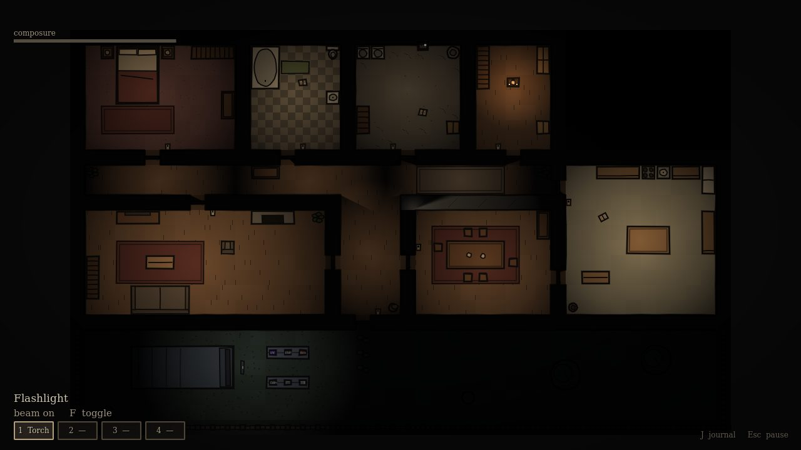
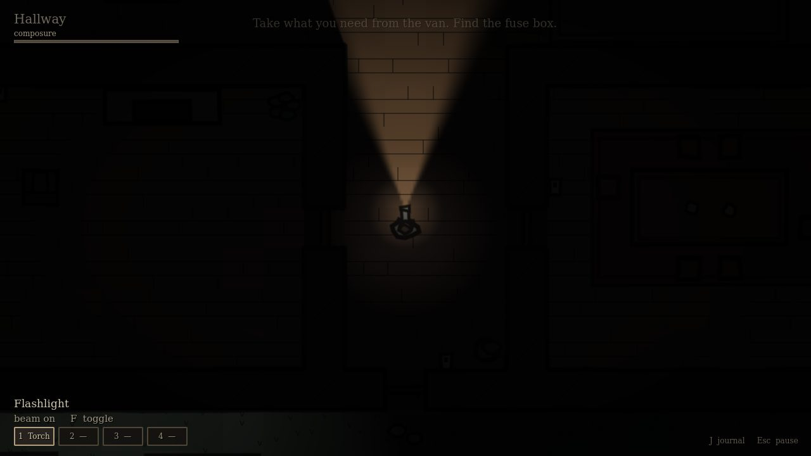
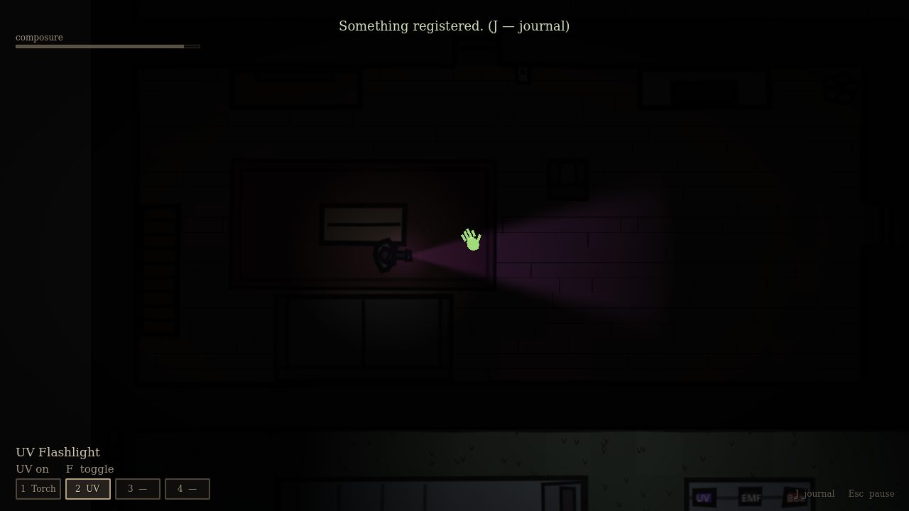
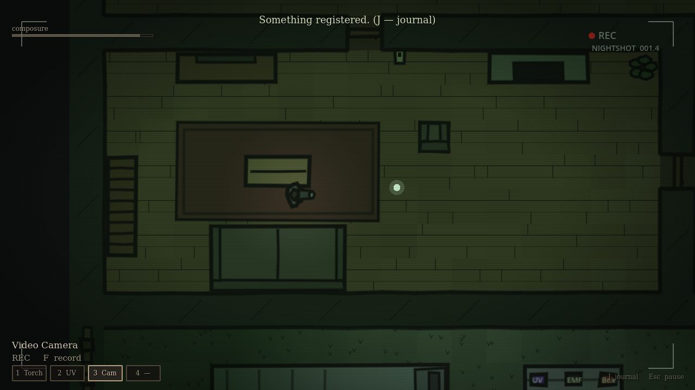
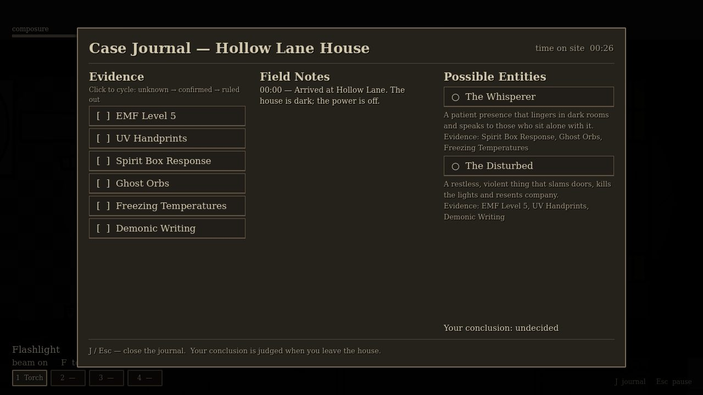
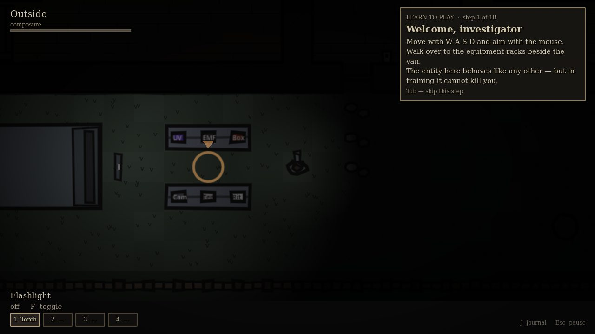
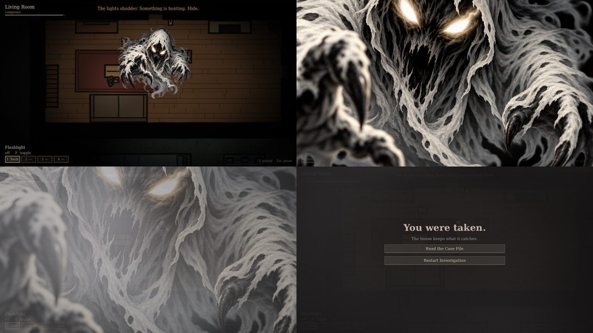

# Ghost Journals

A 2D top-down supernatural investigation / survival-horror prototype built in **Godot 4** with typed GDScript.
Enter the Hollow Lane house, restore the power, gather evidence with your equipment, name the entity in your
journal, survive its hunts — optionally banish it — and leave alive.



| | |
|---|---|
|  |  |
|  |  |

All screenshots are real frames rendered by the game (see [Testing](#testing)).

---

## Godot version

* **Godot 4.6 stable** (`4.6.stable.official.89cea1439`), standard (non-.NET) build.
* Renderer: **Compatibility** (OpenGL 3 / GL Compatibility) — works on modest Windows PCs.
* Target platform: Windows PC. A `Windows Desktop` export preset is included (`export_presets.cfg`).

## How to launch

1. Install Godot 4.6 (or newer 4.x) from <https://godotengine.org/download>.
2. Open Godot → **Import** → select this folder's `project.godot`.
3. Press **F5** (Run Project). The main menu opens.
4. Click **Learn to Play (Tutorial)** for a guided training case, or **Begin Investigation** for a real one.

To build a Windows executable: *Project → Export → Windows Desktop → Export Project* (requires the
Godot export templates, installed from the editor via *Editor → Manage Export Templates*).

Command line (optional):

```
godot --path . -- --debug-mode          # start with debug tools enabled
godot --path . -- --ghost=disturbed     # force a ghost type (whisperer | disturbed)
```

## Controls

All bindings live in *Project Settings → Input Map* and can be rebound there.

| Key | Action |
|---|---|
| W A S D | Move |
| Mouse | Aim / facing (flashlight and camera follow it) |
| Shift | Sprint (short stamina) |
| E | Interact (doors, fuse box, switches, pickups, notebooks). Some actions are **hold E** |
| F | Use the held equipment (toggle / record / lay the ritual circle) |
| G | Drop the held equipment |
| 1 – 4 | Select equipment slot |
| J | Open / close the journal |
| Esc | Close the journal / pause menu |
| Tab | Skip the current tutorial step (Learn to Play only) |

Debug mode (enable on the main menu, or `-- --debug-mode`):

| Key | Debug action |
|---|---|
| F3 | Toggle debug overlay (ghost type, state, position, room, sanity, hunt chance) and world markers (ghost, path, EMF sources, hidden orbs) |
| F4 | Cycle the evidence type used by F8 |
| F5 | Force a manifestation |
| F6 | Start / end a hunt |
| F7 | Toggle electrical power |
| F8 | Generate the selected evidence event next to the player |
| F9 | Reveal the ghost (faint) |
| F10 | Reset the investigation |

Debug functionality is off by default and does nothing during ordinary play.

## Learn to Play (tutorial)



**Learn to Play** on the main menu starts a guided training investigation in the same house. The ghost is a
normal ghost type (random), running the same AI: it roams, interacts, leaves evidence, manifests and hunts
exactly as in a real case. The only difference is that **it cannot kill you**. If it catches you, you get the
full scare, the hunt ends and the investigation continues.

An instruction card (top right) walks through 18 steps, each completed by actually doing it:
moving → flashlight → taking the Thermometer, EMF Reader and UV Flashlight → entering the house → the fuse box
→ light switches → finding the cold room with the thermometer → an EMF reading → sweeping with UV → swapping
for the Spirit Box and Video Camera at the van → a spirit box session in the dark → recording on camera →
examining a notebook → marking the journal and choosing a conclusion → the warded safe room → a **practice
hunt** → the (optional) exorcism → leaving.

* A pulsing ring marks the current objective (the racks, the fuse box, the ghost's room, the latest disturbance…);
  when it is off-screen, a chevron beside the investigator points the way.
* A live hint line reacts to the situation, for example "The lights in the Kitchen are on. Switch them off.", "The power is out…",
  or "Select it with its number key, then press F", so a step never stalls silently when the ghost undoes something.
* **Tab** skips a step. The case file at the end is marked as a training investigation.

## How to play (a short field guide)

1. You arrive at the van with a **flashlight**. Six more tools lie on the van's racks; you can carry **four**.
   Taking an item with full hands swaps it with the held one (the old item is left on the rack).
2. The house is **dark and unpowered**. The **fuse box** is in the Utility Room (hold E).
   Power lights the rooms (each room also has a light switch), and powers the **warding lamp** in the Storage Room.
3. Investigate. Evidence is generated by the ghost's actual behaviour, never at random:

| Evidence | How to find it |
|---|---|
| EMF Level 5 | Keep the EMF reader on near spots the ghost just disturbed (doors, switches, knocks). Levels 2–4 are common; **5** only comes from some ghosts. |
| UV Handprints | Sweep the UV flashlight over doors and switches the ghost touched. Prints are invisible otherwise. |
| Spirit Box Response | Spirit box on, close to the presence, **in a room with its lights off**. |
| Ghost Orbs | Record with the video camera in the room the ghost haunts. Orbs only appear on camera. |
| Freezing Temperatures | Thermometer below **0 °C**. Every ghost chills its room; only some freeze it. |
| Demonic Writing | Old notebooks lie in a few rooms. Examine them (E) after activity nearby. |

4. Open the **journal (J)**. Field notes record what your equipment really detected. Mark each evidence
   *unknown → confirmed → ruled out*; entities that don't fit are excluded. Select your conclusion.
5. Low **composure (sanity)** makes the ghost more active and enables **hunts**. During a hunt the lights
   flicker, the front door locks, and you hear heavy footsteps. Break line of sight and hide, or reach the
   **Storage Room while the power is on** — the warding lamp keeps the ghost out. If the power dies, so does the ward.
6. Optional **exorcism**: carry the ritual kit, press F to lay the salt circle where the ghost dwells, name the
   entity in the journal, then **hold E for 7 s** while it is near the circle. It may snuff the candles or attack.
   Speaking the **wrong name** fails the rite and enrages it.
7. Return to the **van door** and hold E to leave. The case file shows the true entity, your conclusion,
   evidence detected, exorcism outcome and survival. Start a new investigation from there.

## Implemented features

* **Player**: CharacterBody2D movement, sprint with stamina, mouse-aimed facing, wall/furniture/door collision,
  footsteps, equipment anchor that rotates with facing (no animation-frame dependency).
* **House**: one handcrafted, *data-driven* layout (`resources/layouts/old_house_layout.gd`) with 8 rooms
  (living room, kitchen, dining room, master bedroom, bathroom, utility room, hallway, storage room) plus the yard.
  Walls, collision, light occluders, doors, furniture, room lights, switches and navigation are all generated from it.
* **Doors**: open/close, block movement and light when closed, shared interaction contract, used by the ghost
  (slams, opens doors in its path), front door locks during hunts.
* **Interaction system**: one `Interactable` base class with range, line-of-sight reach, facing preference,
  highlight brackets, context prompts (`E — Open Door`), hold interactions with progress and status, enable/disable.
* **Lighting**: global darkness (CanvasModulate), per-room lights with wall shadows, flashlight cone with shadows,
  faint personal glow, hunt flicker, night-vision tint while recording.
* **Electrical system** with named circuits (one used), fuse box, power-dependent room lights, ghost power trips.
* **Safe room** whose protection depends on power; ghost navigation excludes the room while protected; the
  ghost cannot target a player inside it; composure recovers there; atmospheric feedback (warding lamp, messages).
* **Equipment** (4-slot inventory, shared `Equipment` interface, one script each): flashlight, UV flashlight,
  EMF reader (levels + LEDs + beeps), spirit box (static + responses), video camera (overlay + orbs), thermometer,
  ritual kit. Pickups, swapping and dropping.
* **Evidence**: six data-driven `EvidenceDefinition` resources, generated through gameplay, with cooldowns,
  probabilities and context requirements; subtle cue + field note on first detection; never auto-confirmed.
* **Ghosts**: `GhostDefinition` resources (The Whisperer, The Disturbed) drive one shared `GhostController`
  state machine (Dormant, Roaming, Interacting, Manifesting, Hunting, Recovering, Banished), AStarGrid2D
  navigation, favourite room chosen by darkness preference, door/light/object/writing/power interactions,
  whispers, manifestations that are only visible when the player faces them with line of sight and light,
  a detailed horror transformation on catch.
* **Sanity**: 0–100 with documented, configurable rates (`GameBalance` resource): darkness, flashlight
  (partial protection), power loss, ghost proximity, manifestations, witnessed events, hunts, safe room recovery.
  Lower sanity raises ghost activity, manifestations and hunt chance; a vignette tightens.
* **Hunts**: start conditions (sanity threshold, cooldown, first-hunt grace, proximity aggression), grace period,
  line-of-sight chase with last-known-position search (not omniscient), short-range sensing, door forcing,
  heavy footsteps, flicker, locked exit, catch → horror reveal → death screen.
* **Journal & identification**: three-state evidence marks, consistent filtering, ghost descriptions,
  conclusion selection, judged only at the end.
* **Exorcism**: ritual kit → circle → hold-E rite requiring the ghost nearby and a named entity; interruptions;
  wrong name triggers a hunt; success banishes the ghost.
* **Game loop & UI**: main menu, HUD (held item + reading, prompt, composure, room name, notices), journal,
  pause menu, death screen, results/case file, restart (75 % chance of meeting a different ghost type).
* **Audio**: `AudioManager` with Ambience / Equipment / Ghost / Player / UI / Music buses, positional sounds,
  and every sound synthesized procedurally at startup (no third-party audio).
* **Learn to Play tutorial** (see above).
* **Debug mode** (see controls).

## Known limitations

* Placeholder procedural art and synthesized audio only. Fonts use system serif faces (Georgia on Windows).
* The video camera can be dropped (G) but a *placed* camera does not record; orbs are only visible through the
  held camera. There is no monitor/surveillance view.
* One ritual type; one house; two ghost types; the yard is not part of ghost navigation (the ghost never leaves the house).
* The ghost moves on a tile grid (AStarGrid2D) instead of NavigationAgent2D; it opens closed doors rather than
  being blocked by them.
* Hiding has no dedicated mechanic (closets etc.); you hide by breaking line of sight or using the safe room.
* No settings menu (volume, key rebinding UI) — rebind in the Input Map.
* Balance is first-pass (see `tests/balance_probe.gd`) and has not been tuned through human playtesting.

## Project architecture

```
res://
  project.godot            Input map, autoloads, Compatibility renderer
  scenes/
    main/                  main_menu.tscn, investigation.tscn (game root)
    player/  ghosts/       player.tscn, ghost.tscn
    environment/           door, furniture, light switch, fuse box, warding lamp, notebook, exit, ritual circle
    equipment/             one scene per tool + equipment_pickup.tscn
  scripts/
    core/                  GameManager & AudioManager (autoloads), InkStyle (visual config), AudioSynth,
                           GameDatabase, GameBalance, DebugFlags
    interactions/          Interactable base, InteractionSystem, highlight
    environment/           House (builder + spatial queries + navigation), RoomData, Door, Furniture, layers
    evidence/              EvidenceDefinition, JournalLogic, EmfSource, UvPrint, GhostOrb, WritingBook
    ghost_ai/              GhostDefinition, GhostController, GhostVisual, HuntDirector
    systems/               InvestigationManager, ElectricalSystem, FuseBox, SafeRoomController, WardingLamp,
                           TemperatureSystem, LightingController, RitualCircle, EquipmentPickup, ExitPoint
    player/                Player, PlayerVisual, SanityComponent, EquipmentManager
    equipment/             Equipment base + Flashlight, UvFlashlight, EmfReader, SpiritBox, VideoCamera,
                           Thermometer, RitualKit, EquipmentDefinition
    ui/                    UiTheme, Hud, JournalUI, PauseMenu, DeathScreen, ResultsScreen, CameraOverlay,
                           DebugOverlay, main_menu
    main/                  Investigation (scene root / game loop)
  resources/
    game_database.tres     Registry of all definitions below
    ghosts/ evidence/ equipment/ balance/   Data resources (.tres), editable in the inspector
    layouts/               old_house_layout.gd (house data)
  tests/                   run_tests.gd, balance_probe.gd, capture.gd, check_scripts.gd
  tools/                   build_resources.gd (generates the initial .tres data)
  assets/                  sprites/ audio/ fonts/ — drop-in replacements (see below)
```

**Ownership & communication.** Only two autoloads exist: `GameManager` (scene flow, debug flag, ghost rotation,
database) and `AudioManager` (buses + sounds). Everything else is owned by the `Investigation` scene root,
which builds the world from data, creates the systems and injects references. Systems talk through signals
(`power_changed`, `protection_changed`, `evidence_observed`, `player_caught`, `hunt_started`, …).
`InvestigationManager` owns investigation state (observations, journal marks, conclusion, outcome); UI only
reads it. Gameplay queries (is this point lit? which room? can the ghost walk here?) go through `House`,
never through the renderer, so visuals can change freely.

**Adding content.**
* *Ghost type*: create a `GhostDefinition` resource (evidence list + behaviour numbers) and add it to
  `game_database.tres`. No controller changes needed.
* *Evidence type*: add an `EvidenceDefinition`, reference it from ghosts, and call
  `InvestigationManager.observe(id, room)` from whatever detects it.
* *Equipment*: subclass `Equipment`, make a scene, add an `EquipmentDefinition`.
* *House*: write another layout dictionary (same format) — a procedural generator only has to emit it.
* *Ritual*: `RitualCircle` is self-contained; new rituals can be sibling `Interactable`s.

**Replacing placeholder art and audio.** Colours and stroke widths live in `scripts/core/ink_style.gd`.
The ghost uses the hand-drawn token `assets/ghost/GhostToken.png`, set per ghost type in its
`GhostDefinition` (`sprite`, `sprite_world_height`). It is drawn upright like a game piece, mirrors to face its
direction of travel and leaves a grey smoke trail while it is visible and moving (`smoke_trail`; see
`scripts/ghost_ai/smoke_trail.gd`). The trail obeys the same perception rule as the ghost.
When the ghost catches the investigator, a **jump scare** plays: `audio/Ghost_caught_player_scream.wav` and
the splash `assets/ghost/Ghost_caught_player.png`, which lunges from the ghost's position toward the
investigator, accelerating until it covers the screen, shudders, then dissolves into fog that clears onto the
death screen (in the tutorial, the hunt simply ends). Both are per-ghost data (`caught_sprite`, `caught_sound`);
the effect lives in `scripts/ui/jump_scare.gd`.



Any other visual looks for a PNG first and falls back to procedural drawing:
`assets/sprites/furniture/<type>.png`, `player/investigator.png` (facing +X), `ghost/silhouette.png`,
`ghost/horror.png`, `equipment/<id>.png`, `environment/door.png`, `environment/fuse_box.png`.
Sounds: drop `assets/audio/<name>.ogg` or `.wav` (names in `scripts/core/audio_manager.gd`, e.g. `whisper`,
`door_open`, `hunt_start`) to override the synthesized version. No gameplay code changes are needed.

## Testing

Everything below was actually run in a Linux container with Godot 4.6 stable.

| Kind | Command | Result |
|---|---|---|
| Script compilation | `godot --headless --path . -s res://tests/check_scripts.gd` | 67 scripts, 0 failures |
| Automated tests (unit + headless integration) | `godot --headless --path . --fixed-fps 60 -s res://tests/run_tests.gd` | **181 passed, 0 failed** |
| Scene smoke runs | `godot --headless --path . --quit-after 300` and the investigation scene directly | no errors |
| Balance probe | `godot --headless --path . --fixed-fps 60 -s res://tests/balance_probe.gd` | see below |
| Rendered frames | `xvfb-run godot --path . --rendering-driver opengl3 -s res://tests/capture.gd -- overview` | screenshots in this README |
| Export | `godot --headless --path . --export-pack "Windows Desktop" out.pck`, then ran the pack | loads and runs the investigation |

The integration tests drive real investigation scenes: doors block and open, the fuse box powers lights and
the ward, pickups/swap/drop, each evidence type is detectable with the right tool and *only* produced by the
right ghost, spirit box conditions, camera-only orbs, perception-dependent visibility, a hunt that catches a
player in the open, the safe room protecting a player through a hunt, exorcism success and failure, journal
filtering and input routing (J / Esc / 1–4 / F / G), results and restart. The tutorial tests check that the
ghost is a normal definition running its normal AI, that a catch is not fatal, that the practice hunt starts
and completes, and that every equipment step is completable through the ghost's natural behaviour for
**both** ghost types without skipping (following the objective marker and live hints, as a player would).

Balance probe (passive player standing in the ghost's room, power off, no flashlight — the harshest case):
each evidence type became detectable within roughly 15–160 s; first hunts occurred at about 2–3.5 minutes.

**Not tested:** no human has played the game with a keyboard and mouse. Rendering was verified on Mesa
llvmpipe (software OpenGL), not on Windows hardware; audio ran on a dummy driver, so the synthesized sounds
were never listened to. Feel, difficulty and readability need manual playtesting.
